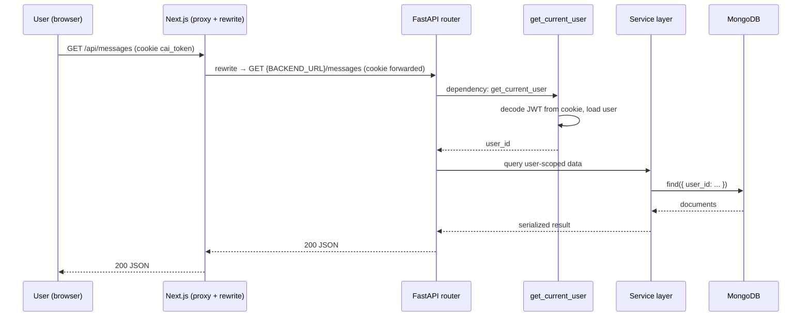
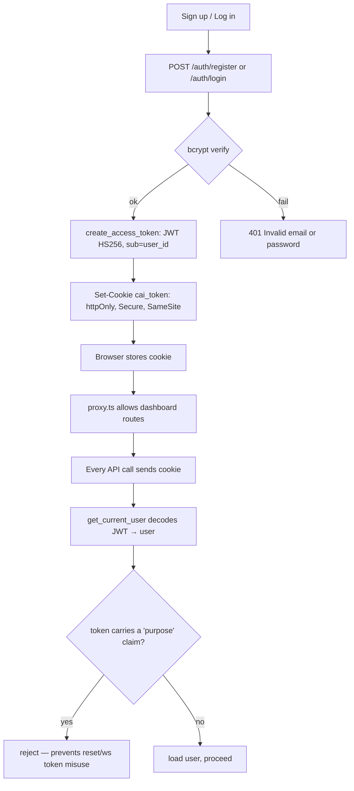
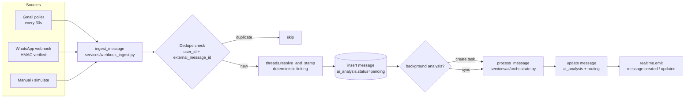
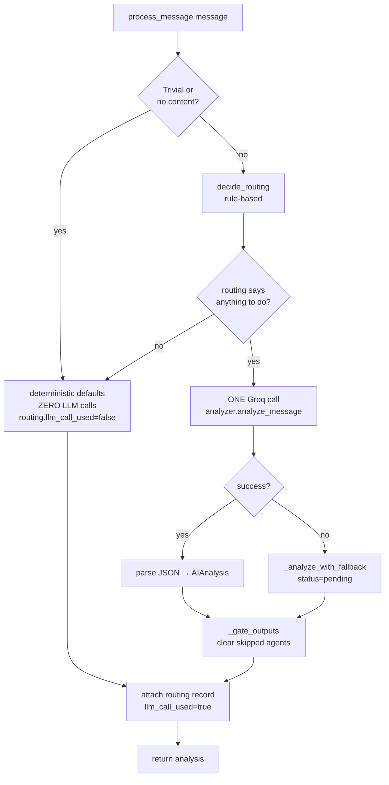
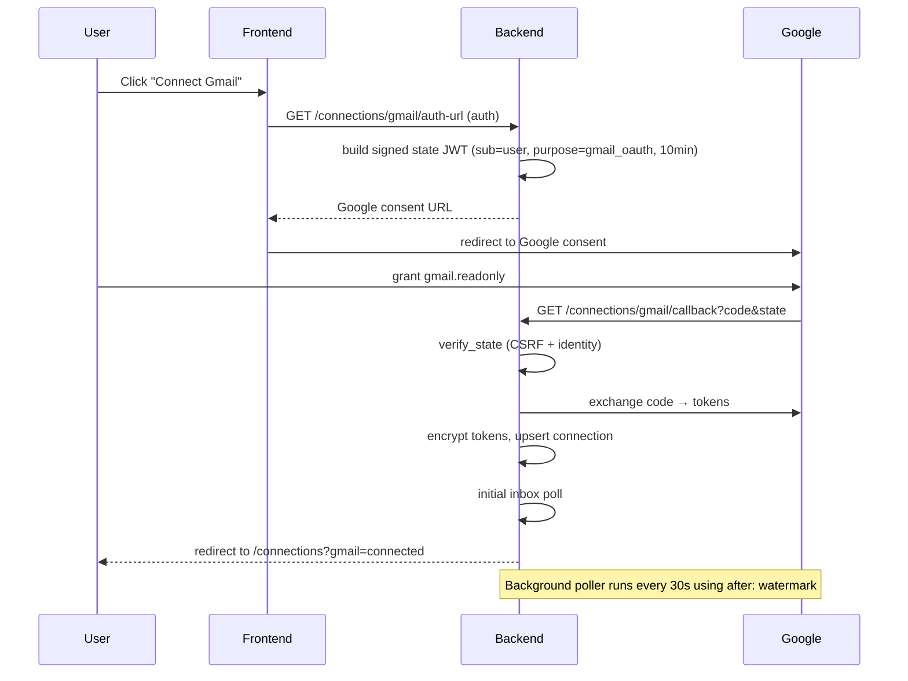

# 02 — System Architecture

> How the whole system is put together, with diagrams. Read `00_PROJECT_OVERVIEW.md` first if you are new. Every diagram here reflects the actual code.

---

## 1. The 30,000-foot view

Sift is a classic **three-tier web application**:

1. **Presentation tier** — a Next.js app (browser) that renders all screens and also proxies API calls to the backend.
2. **Application tier** — a FastAPI backend that owns all business logic, authentication, AI calls, and integrations.
3. **Data tier** — a MongoDB Atlas database.

Around the application tier sit **external services**: Groq (AI), Google (Gmail OAuth), Meta (WhatsApp webhook), and Brevo (email).

```
┌─────────────────────────────────────────────────────────────────────┐
│                          BROWSER (User)                              │
│  Next.js App Router  ·  React 19  ·  Tailwind v4  ·  recharts        │
│  Auth cookie: cai_token (httpOnly)                                   │
│  Assistant: Kestrel (voice + text)  ·  WebSocket client              │
└───────────────┬─────────────────────────────────────────────────────┘
                │  HTTPS  (same origin)
                │  /api/*  ──rewritten by Next──►  FastAPI
                │  /ws     ──direct WebSocket───►  FastAPI
┌───────────────▼─────────────────────────────────────────────────────┐
│                      NEXT.JS SERVER (Vercel)                         │
│  proxy.ts   → route protection (checks cai_token presence)          │
│  next.config.ts rewrites /api/* → BACKEND_URL                       │
│  app/api/auth/logout → forwards + clears cookie                     │
└───────────────┬─────────────────────────────────────────────────────┘
                │  BACKEND_URL (server-to-server)
┌───────────────▼─────────────────────────────────────────────────────┐
│                    FASTAPI BACKEND (Vercel)                          │
│  Routers: auth · messages · webhooks · gmail · connections ·         │
│           tasks · analytics · jarvis · ws                            │
│  Services: ai/orchestrate (ONE AI entry) · jarvis_* · gmail ·        │
│            webhook_ingest · threads · realtime · retry_pending ·     │
│            analytics · password_reset · security                     │
│  Background loops (lifespan): Gmail poller · pending-retry sweep     │
└───┬───────────────┬────────────────┬───────────────┬────────────────┘
    │               │                │               │
    ▼               ▼                ▼               ▼
┌────────┐   ┌───────────┐   ┌────────────┐   ┌─────────────┐
│ MongoDB│   │  Groq API │   │ Google     │   │ Meta / Brevo│
│ Atlas  │   │  (LLM)    │   │ Gmail API  │   │ WhatsApp /  │
│        │   │           │   │ (OAuth)    │   │ Email       │
└────────┘   └───────────┘   └────────────┘   └─────────────┘
```

**Key architectural decision:** the browser never talks to FastAPI directly in the normal flow. It calls `/api/...` on its own origin, and Next.js rewrites those to the backend. This keeps the `httpOnly` `cai_token` cookie on the same origin and avoids CORS/cookie problems.

---

## 2. Request lifecycle (a normal API call)



Every protected endpoint depends on `get_current_user` (`backend/dependencies.py`), which is why **every query can and must be scoped by `user_id`**.

---

## 3. Authentication architecture



- Password reset tokens and WebSocket tokens are **also JWTs but carry a `purpose` claim**, so they can never be used as session cookies. `decode_token` rejects any token with a `purpose` claim (`backend/services/security.py`).
- There is **no refresh-token flow**; the session simply lasts 7 days (`TOKEN_EXPIRY_DAYS`).
- Logout is handled by the Next route `app/api/auth/logout/route.ts`, which clears the cookie even if the backend is unreachable.

---

## 4. Message ingestion architecture (three sources, one path)

All message sources converge on **one** ingest function so that dedupe, thread-linking, and AI analysis behave identically everywhere.



Notes:
- `POST /messages` runs analysis **synchronously**; the webhook `simulate` path runs it as a **background task** (so the HTTP response returns `ai_analysis: null` immediately).
- Dedupe uses the composite index `{user_id, external_message_id}` (added in the security phase; the legacy global index is dropped at startup).

---

## 5. AI processing architecture

The single most important rule in the backend: **routes and services must never call `analyze_message` directly.** Everything goes through `process_message`.



- **Rule-based routing first** (`services/ai/routing.py`) decides which of the 5 "agents" (priority, summary, task_extraction, deadline_detection, recommended_action) are needed.
- **One combined LLM call** produces all needed outputs at once — this is why it is **not** a true multi-agent system, and why the docs must not call it one.
- The `routing` record is attached on **every** path so the UI can explain *why* the AI did what it did.
- Failures are stored as `status="pending"` and later retried by `services/retry_pending.py`.

Full detail: `06_AI_AND_AGENTIC_SYSTEM.md`.

---

## 6. Assistant (Kestrel / JARVIS) architecture

The assistant is a **layered, deterministic-first** command router. Later phases only run if earlier phases decline the command, which keeps behaviour stable and testable.

```mermaid
flowchart TD
    CMD[POST /jarvis/chat message] --> EMPTY{empty?}
    EMPTY -->|yes| E400[400]
    EMPTY -->|no| P4[Phase 4: detect_message_intent<br/>message-content questions]
    P4 -->|matched| RUN4[run_message_intent<br/>user-scoped DB reads]
    P4 -->|owned elsewhere| P2
    P2[Phase 2: actions<br/>create/complete/delete task,<br/>search, summarize, attention, draft] -->|matched| RUN2[execute / request confirmation]
    P2 -->|no| P3[Phase 3: detect_intent<br/>navigation + real-data info]
    P3 -->|matched| RUN3[_dispatch_intent<br/>nav action or info reply]
    P3 -->|no| P1[Phase 1: route_command<br/>greeting / help / nav / info / unknown]
    P1 -->|known| RUN1[deterministic reply or nav action]
    P1 -->|unknown| P5[Phase 5: _handle_chat<br/>Groq chat if configured,<br/>else CONVERSATION_UNAVAILABLE_REPLY]
    RUN4 --> REC[_record_turn<br/>context for follow-ups]
    RUN2 --> REC
    RUN3 --> REC
    RUN1 --> REC
    P5 --> REC
    REC --> OUT[{reply, action, used_ai}]
```

- **Context memory** (Phase 5) stores the last 8 turns per user in memory and enables follow-ups like "what about those?" after a message listing.
- Voice is entirely frontend: `useSpeechRecognition` (Web Speech API) → text → the same `/jarvis/chat` endpoint; `useSpeechSynthesis` speaks the reply back in chunks.
- **Barge-in**: when TTS starts, the mic is "silently armed"; if the user speaks, TTS is cancelled and a stale-response guard (`generationRef`) prevents the old reply from overwriting state.

Detail: `06_AI_AND_AGENTIC_SYSTEM.md` and `04_FRONTEND_EXPLAINED.md`.

---

## 7. Gmail OAuth architecture



- Scope is **only** `gmail.readonly`.
- The callback is deliberately **not** auth-gated (Google calls it), so identity is proven by the signed `state`.
- Refresh tokens are required; if a token can no longer be refreshed, the connection is marked `error` and the UI shows a "Reconnect" CTA.

Detail: `08_GMAIL_OAUTH.md`.

---

## 8. Realtime architecture

```mermaid
flowchart LR
    subgraph Backend
      EV[message.created / message.updated] --> CM[ConnectionManager]
      CM --> CM2[map user_id → set of sockets]
    end
    CM2 -->|fan-out only to that user| WS1[User A socket]
    CM2 --> WS2[User B socket]
    WS1 --> R[RealtimeProvider<br/>useRealtime().version]
    R --> UI[Dashboard / lists re-render]
    WS1 -. on failure .-> POLL[fallback polling every 15s]
```

- Fan-out is strictly per-user; a socket never receives another user's events.
- The frontend has two fallbacks: a provider-level 15 s poll and, in `MessageList`, a 2.5 s poll **only while some message is still un-analysed**.
- A dev-only `?token=` WebSocket auth path exists, gated by `WS_ALLOW_QUERY_TOKEN`; production relies on the cookie.

---

## 9. Background work (runs inside the backend process)

Started in `main.py`'s lifespan:

| Loop | When it runs | What it does |
|------|--------------|--------------|
| **Gmail poller** | Only if `GOOGLE_CLIENT_ID` is set and not on the test DB | Every `GMAIL_POLL_INTERVAL_SECONDS` (default 30 s), fetches new inbox mail per connected user using an `after:` watermark. |
| **Pending-retry sweep** | Always (skipped on test DB) | Every `RETRY_INTERVAL_SECONDS` (default 60 s), re-runs `process_message` for messages stuck at `ai_analysis.status="pending"`. |

Both are in-process asyncio tasks (no separate worker/queue). This is simple and fine for an FYP, but it means the backend must run as a long-lived process for them to work.

---

## 10. Deployment topology (as implied by the code)

```
Vercel project 1 ──► Next.js frontend  (https://fyp-f8vk.vercel.app)
Vercel project 2 ──► FastAPI backend   (https://fyp-omega-peach.vercel.app)
MongoDB Atlas    ──► database
Google Cloud     ──► OAuth client (gmail.readonly)
Groq             ──► LLM inference
Brevo            ──► transactional email
Meta             ──► WhatsApp webhook → backend
```

`next.config.ts` requires `BACKEND_URL` in production; `.env.example` shows the expected backend URL. CORS and cookies (`COOKIE_SECURE`, `COOKIE_SAMESITE`) must be configured for cross-site cookies between the two Vercel domains.

Deployment detail and caveats: `11_TESTING_AND_DEPLOYMENT.md`.

---

## 11. Design principles the code actually follows

1. **Deterministic first, AI second.** Routing, attention, thread-linking, and assistant navigation are pure rules. AI is used only where language understanding is genuinely needed.
2. **One entry point per concern.** `process_message` for message analysis; `process_command` for the assistant; `ingest_message` for ingestion.
3. **User scoping is non-negotiable.** `user_id` is always the first `$match` and the source of every owner id (never the client).
4. **Fail visibly, degrade gracefully.** AI failures become `pending`, not silent wrong answers; assistant replies degrade to deterministic fallbacks.
5. **Explainability.** The `routing` record and `needs_attention` reason are stored so the UI can justify decisions.
6. **No secret leaks.** OAuth tokens encrypted; reset tokens hashed; API keys backend-only.
