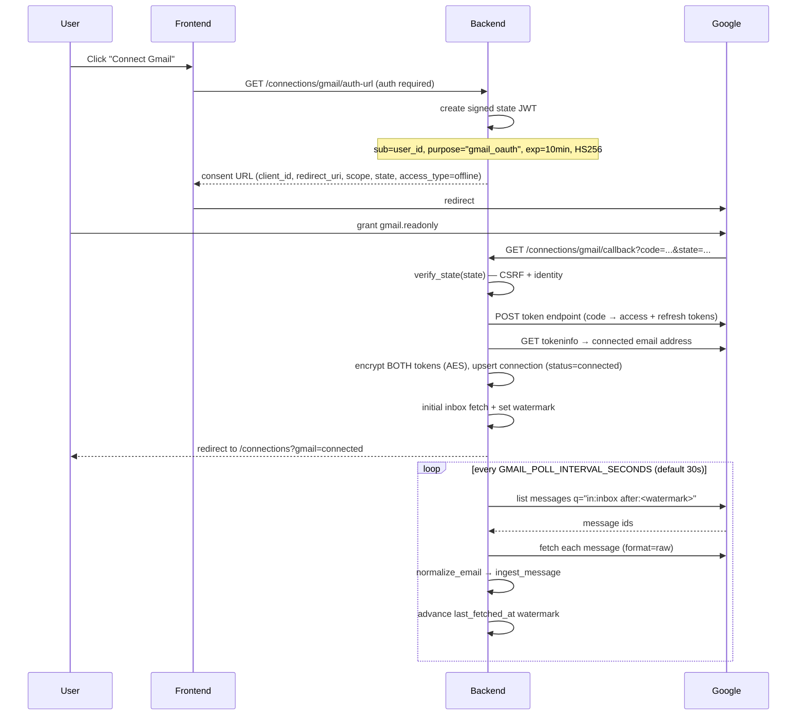

# 08 — Gmail OAuth

> How Sift connects to Gmail safely and read-only, and what a Google reviewer will look at. This is the highest-risk integration in the project because Gmail scopes are "restricted".

---

## 1. Why OAuth (and not a password)

Sift never asks for a Gmail password. Instead it uses **Google's official OAuth 2.0** flow, where the user grants a limited, revocable permission. The permission requested is the narrowest that lets the app read mail.

---

## 2. The scope — read-only, nothing else

```
https://www.googleapis.com/auth/gmail.readonly
```

- This is a **restricted scope** in Google's classification.
- Sift can **read** messages but **cannot** send, delete, or modify anything.
- No other Google scope is requested (no profile, no contacts, no Drive).
- Attachments are **skipped** entirely.

> Because `gmail.readonly` is restricted, **using it in production with real users requires Google's OAuth app verification** — and for restricted scopes, a security assessment (often via a CASA-approved lab) is typically required. **This verification has not been completed in this project.** It is a top item in `15_FINDINGS_AND_GAPS.md`.

---

## 3. The flow, step by step



### The `state` parameter — CSRF and identity
- The `state` is an **HS256 JWT** signed with the app's `JWT_SECRET`.
- It carries `sub = user_id`, `purpose = "gmail_oauth"`, and a **10-minute expiry**.
- `verify_state` returns `None` on **any** mismatch (bad signature, wrong purpose, expired, unknown user).
- This is why the callback endpoint can be **public** (Google calls it) while still being safe: the user is proven by the signed state, not by a cookie.

### Why tokens are encrypted
- Both the access and refresh tokens are encrypted with **AES** (`utils/encryption.py`, key = `ENCRYPTION_KEY`) before being stored.
- The refresh token is **required** — if Google returns no refresh token, the connect is treated as a failure (otherwise the app would lose access after an hour).

---

## 4. The poller

- Started in `main.py`'s lifespan **only if** `GOOGLE_CLIENT_ID` is set **and** the DB is not the test DB (so tests never make real Google calls).
- Interval: `GMAIL_POLL_INTERVAL_SECONDS` (default 30 s).
- Query: `GMAIL_INBOX_QUERY` (default `in:inbox`), paged up to `GMAIL_MAX_PAGES` (default 10) × `GMAIL_MAX_RESULTS` (default 100).
- Watermark: `last_fetched_at` per connection, used as `q=after:<epoch>` so it only fetches new mail.
- A **manual full resync** is available via `POST /connections/gmail/refresh`.

### Email normalisation — `normalize_email`
- Parses MIME with the stdlib `email` package.
- Prefers `text/plain`; falls back to stripped HTML.
- **Skips attachments.**
- `_clean_sender` strips the extra quotes the email parser adds.

> **Real-world gotcha (documented in the code):** `GET .../messages/{id}?format=raw` returns the base64url MIME in the **top-level `raw`** field, while test doubles often nest it under `payload.raw`. `normalize_email` must read `raw.get("raw") or raw["payload"].get("raw")` — otherwise real emails parse with empty sender/content/subject. This was a genuine bug source.

---

## 5. Disconnecting

`DELETE /connections/{id}`:

1. **Best-effort** revoke the token at Google's revoke endpoint.
2. Delete the connection (user-scoped).
3. Messages already imported **remain** in Sift (they are the user's data).

If a token can no longer be refreshed (revoked at Google, password changed, etc.), the poller marks the connection `status="error"` with an `error_message`; the UI shows a **Reconnect** CTA.

---

## 6. Configuration

| Variable | Purpose |
|----------|---------|
| `GOOGLE_CLIENT_ID` | OAuth client id (also gates whether the poller starts) |
| `GOOGLE_CLIENT_SECRET` | OAuth client secret |
| `GOOGLE_REDIRECT_URI` | Must match the Google console exactly |
| `GMAIL_POLL_INTERVAL_SECONDS` | Poll cadence (default 30) |
| `GMAIL_INBOX_QUERY` | Base query (default `in:inbox`) |
| `GMAIL_MAX_RESULTS` / `GMAIL_MAX_PAGES` | Paging caps |
| `ENCRYPTION_KEY` | AES key for token encryption |
| `JWT_SECRET` | Signs the OAuth `state` |
| `FRONTEND_URL` | Where to redirect the browser back to |

Google endpoints are constants in `services/gmail.py` (`GMAIL_AUTH_URL`, `GMAIL_TOKEN_URL`, `GMAIL_REVOKE_URL`, `GMAIL_API_BASE`, `GMAIL_TOKENINFO_URL`). All calls use **httpx** — no Google SDK.

---

## 7. Google Cloud Console setup (checklist)

To make this work in a fresh environment:

1. Create a Google Cloud project.
2. Enable the **Gmail API**.
3. Configure the **OAuth consent screen**:
   - App name, support email, developer contact.
   - Add the `gmail.readonly` scope with a clear justification.
   - Add a **privacy policy URL** (Sift has one: `/privacy`) and terms URL.
   - Add test users while unverified.
4. Create **OAuth client credentials** (Web application) with the exact redirect URIs:
   - `https://<backend>/connections/gmail/callback`
   - `https://<backend>/auth/google/callback` (alias)
   - plus localhost variants for dev.
5. (Production) Submit for verification; expect a security assessment for the restricted scope.

---

## 8. Security properties (viva answers)

| Question | Answer |
|----------|--------|
| Can Sift send or delete email? | No — only `gmail.readonly`. |
| How do you prevent CSRF on the callback? | A signed, short-lived `state` JWT bound to the user. |
| Where are tokens stored? | In MongoDB, encrypted with AES. |
| What if a token is revoked? | Connection → `error`; UI shows Reconnect. |
| Do tests hit Google? | Never — the poller doesn't start on the test DB and httpx is mocked. |
| Can one user read another's mail? | No — every query is `user_id`-scoped and the callback binds the state to the user. |

---

## 9. Known limitations

- **Google verification not done** → restricted scope is not production-approved for public users.
- **Attachments ignored** — only text bodies are analysed.
- **30-second polling** is not instant; a real product would use Gmail push notifications (Pub/Sub).
- **HTML-only emails** are reduced to text (formatting lost).
- **Large mailboxes**: paging caps mean very large initial imports are truncated.
